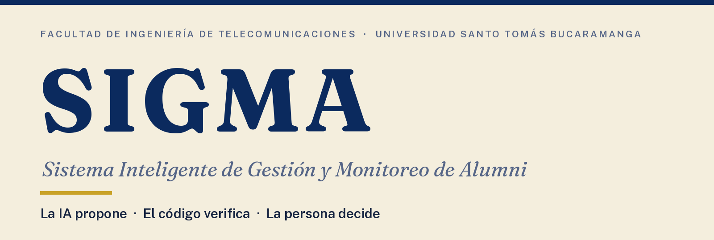
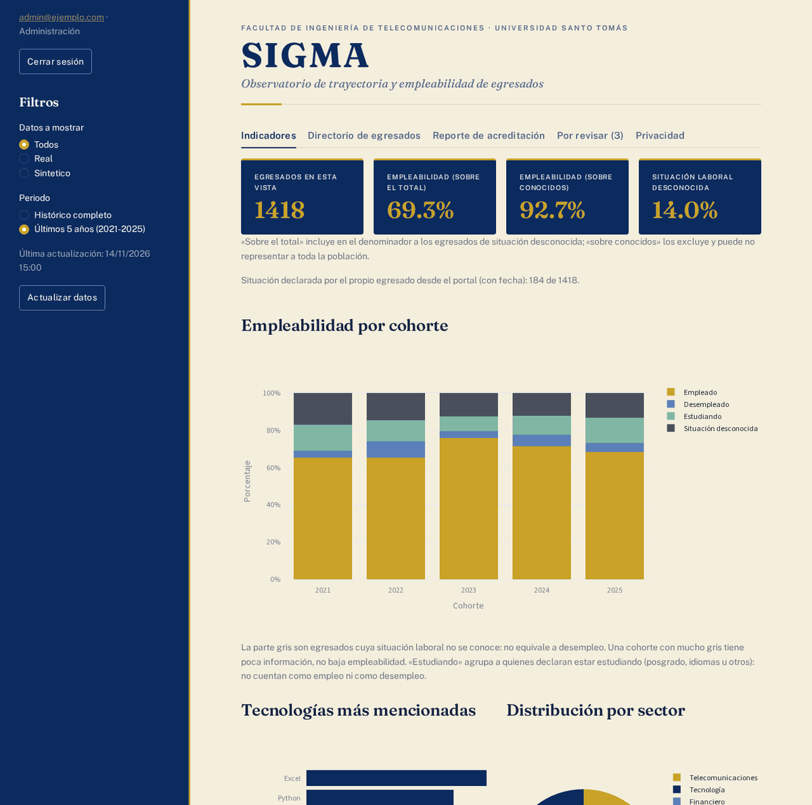
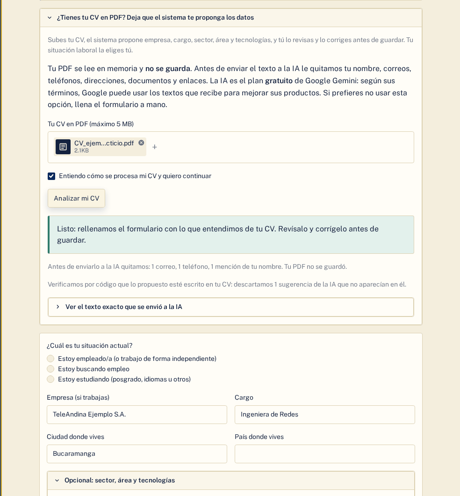
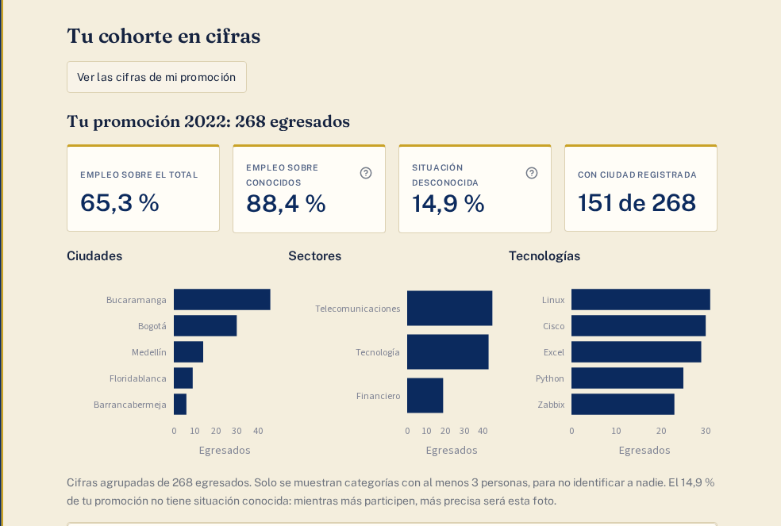
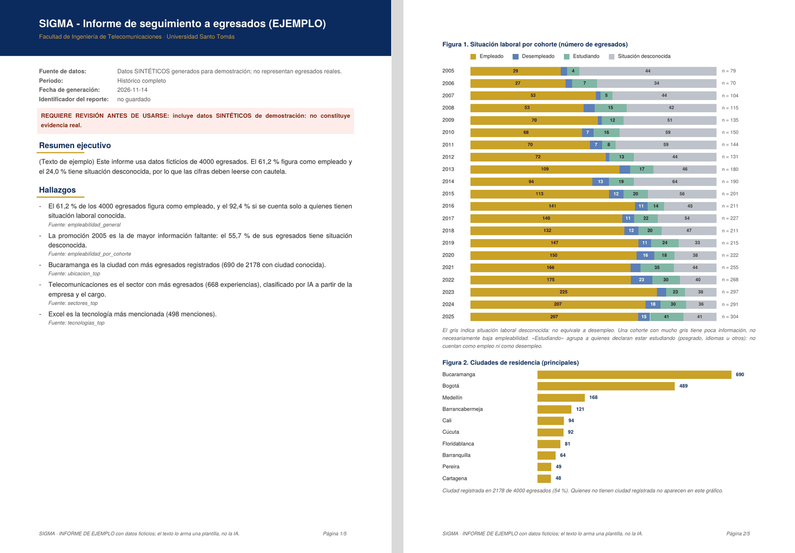
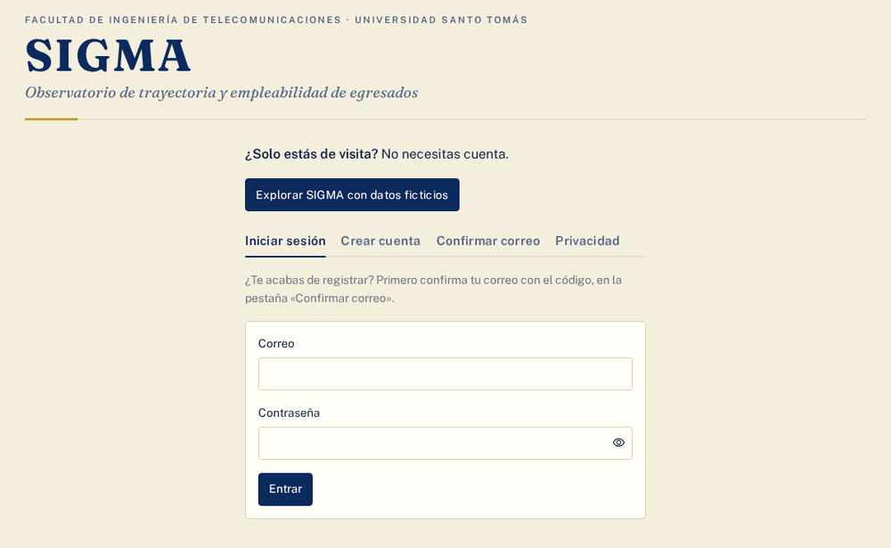
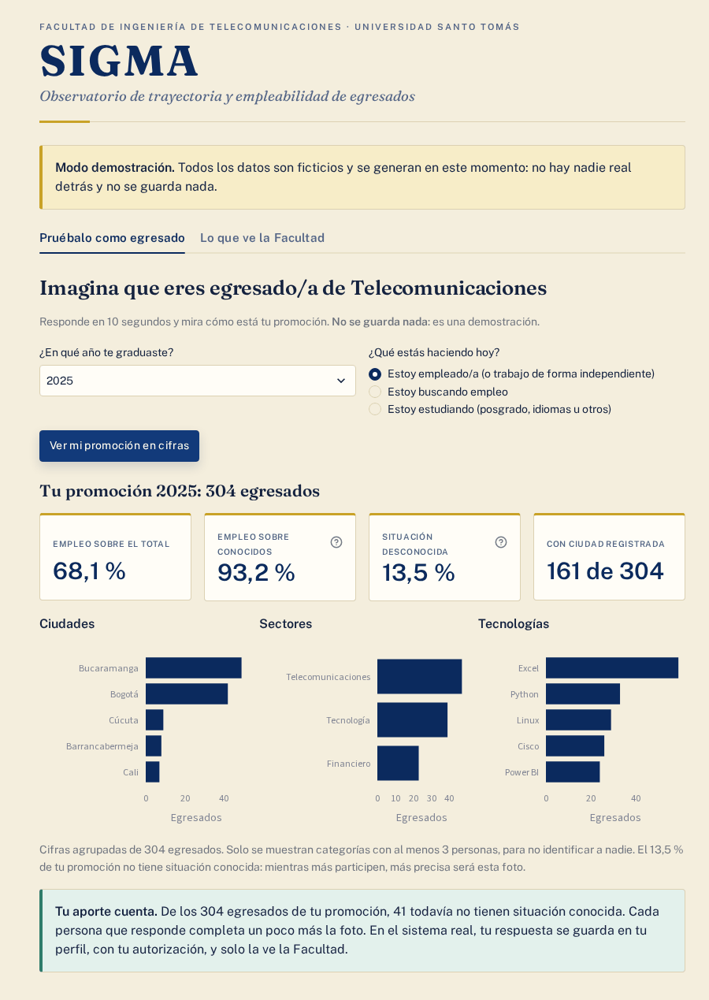
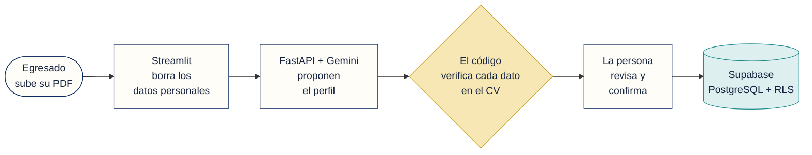
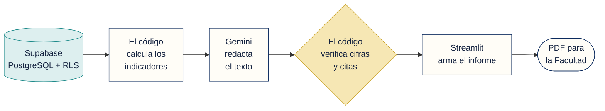

<p align="center">
  
</p>

<p align="center">
  <a href="https://mp5ylwlxsbi89rviejrp2q.streamlit.app/"></a>
</p>

<p align="center">
  
  
  
  
  
  
  
</p>

**SIGMA** mantiene al día la información de los egresados de **Ingeniería de Telecomunicaciones** (Universidad Santo Tomás, Bucaramanga) y entrega a la Facultad **informes de acreditación en los que cada cifra la calcula y la verifica el código, no la IA**. El egresado actualiza su propio perfil, con su autorización y con fecha; a cambio, ve cómo está su promoción.

<sub>*English:* a cloud platform that keeps alumni data current and produces accreditation reports whose every figure is computed and verified by code. AI only proposes and drafts; a person decides.</sub>

> Proyecto Integrador 2026-2 · XXXII FEPROINTEL · Autor: Juan Esteban Páez Fonseca · Asesora: Elizabeth Gelves Gelves · Estado: **funcional (versión 1.0)**

---

## Pruébalo en 2 minutos

<table>
<tr>
<td valign="top">

1. Abre la **[demo en vivo](https://mp5ylwlxsbi89rviejrp2q.streamlit.app/)** (o escanea el código).
2. Pulsa **«Explorar SIGMA con datos ficticios»**. No necesitas cuenta.
3. En **«Pruébalo como egresado»** elige un año de grado y pulsa «Ver mi promoción en cifras».
4. En **«Lo que ve la Facultad»** recorre los indicadores, el directorio y el **reporte de acreditación de ejemplo**, con su PDF.

<sub>Todo lo que ves en la demo es **ficticio** y se genera al momento: no hay nadie real detrás y no se guarda nada. Los servicios usan planes gratuitos: si la app estuvo un rato sin uso, el primer arranque puede tardar hasta un minuto.</sub>

</td>
<td align="center" valign="top">
  <br>
  <sub>Escanéalo con el celular</sub>
</td>
</tr>
</table>

## Así se ve

<table>
<tr>
<td width="50%" valign="top"><br><sub><b>Panel de la Facultad.</b> Empleabilidad por cohorte siempre con sus dos tasas y el porcentaje desconocido (lo gris es lo que no se sabe), sector, áreas, tecnologías y ubicación.</sub></td>
<td width="50%" valign="top"><br><sub><b>Hoja de vida asistida.</b> El sistema dice qué datos personales quitó antes de enviar nada a la IA, descarta lo que la IA propone y no está escrito en el CV, y rellena el formulario para que la persona lo revise.</sub></td>
</tr>
<tr>
<td width="50%" valign="top"><br><sub><b>Tu cohorte en cifras.</b> A cambio de compartir su información, el egresado ve cómo está su promoción, con protecciones para no identificar a nadie.</sub></td>
<td width="50%" valign="top"><br><sub><b>Informe de acreditación en PDF</b> (ejemplo con datos ficticios): gráficos, hallazgos con su fuente, limitaciones y recomendaciones.</sub></td>
</tr>
<tr>
<td width="50%" valign="top"><br><sub><b>Acceso.</b> Demostración sin cuenta, inicio de sesión, registro con código de 6 dígitos y aviso de privacidad.</sub></td>
<td width="50%" valign="top"><br><sub><b>Modo demostración.</b> Pensado para stands y visitas: funciona aunque la base de datos esté pausada.</sub></td>
</tr>
</table>

## El problema

Del registro institucional de **615 egresados, el 44 % no tiene situación laboral conocida** y ningún dato indica cuándo se actualizó. Los informes de acreditación dependen de datos desactualizados y difíciles de verificar.

## Qué hace

**Para el egresado**
- **Cuenta propia** con confirmación por código de 6 dígitos, y un perfil donde cada declaración queda con su fecha y su consentimiento.
- **Hoja de vida asistida (opcional).** Sube su PDF, la IA propone empresa, cargo, sector, área y tecnologías, y la persona revisa y corrige antes de guardar. La situación laboral nunca se rellena sola.
- **Tu cohorte en cifras.** Solo después de guardar su propia información (primero compartes tu parte, después ves la de todos). No se muestra una promoción de menos de 10 personas ni una categoría de menos de 3.
- **Privacidad y derechos.** Aviso de privacidad dentro de la app, con el texto de autorización de la Facultad, y descarga de una copia de sus datos.

**Para la Facultad**
- **Panel de indicadores**: empleabilidad por cohorte, sector, áreas de desempeño, tecnologías y ubicación. Los datos reales y los sintéticos están siempre separados y etiquetados.
- **Informe de acreditación en PDF**, con narrativa redactada por IA a partir de indicadores calculados por código y verificación automática de cifras y citas. También se descargan los indicadores en CSV.
- **Revisión de perfiles nuevos**: se aprueban o se descartan viendo lo declarado y los posibles duplicados.
- **Integración con otras aplicaciones**: un punto de acceso de solo lectura (`GET /api/indicadores`) entrega indicadores agrupados, sin datos de personas, en JSON o CSV, para llevarlos a Excel, Power BI u otro sistema.

## Cómo trabajan juntas las piezas

SIGMA tiene dos recorridos principales, y en los dos la IA nunca tiene la última palabra.

**El PDF que se lee: la hoja de vida del egresado.** Streamlit lee el PDF en memoria y borra los datos personales antes de enviar nada; el servicio de agentes le pide una propuesta a Gemini y el código comprueba que cada dato esté escrito en el CV; la persona revisa y confirma, y solo entonces se guarda.



**El PDF que se genera: el informe de acreditación.** El código calcula los indicadores en la base de datos, Gemini redacta el texto a partir de ellos y el código verifica que cada cifra y cada cita existan antes de armar el PDF.




| Capa | Tecnología |
|---|---|
| Aplicación web | Streamlit |
| Agentes de IA | FastAPI + Gemini |
| Datos, autenticación y permisos | Supabase (PostgreSQL con permisos por fila) |

## Principios de diseño

> **La IA propone, el código verifica, la persona decide.**

1. **El código calcula.** Los indicadores salen de SQL y pandas, no de la IA.
2. **La IA propone o redacta.** Clasifica sector y área, lee CV y escribe la narrativa del informe.
3. **El código verifica.** Cada cifra citada en un informe y cada dato propuesto desde un CV debe existir en los datos de origen; si no, se descarta o el informe se marca «requiere revisión».
4. **Privacidad primero.** Antes de enviar un CV a la IA se le quitan nombre, correos, teléfonos, direcciones, documentos y enlaces; el PDF no se guarda; la persona acepta y puede ver el texto exacto que se envió.

## Evidencias

| Qué se comprobó | Resultado |
|---|---|
| Pruebas automáticas (`python tests/ejecutar_todas.py`) | **237 aprobadas** sin necesidad de claves; **348** si se instalan las librerías de las pruebas de SQL |
| Permisos contra una base real (`python verificar_rls.py`) | **16 de 16** puntos cerrados: 9 tablas y 7 funciones, sin sesión |
| Escala (`tests/prueba_escala.py`) | Lectura, informe, PDF y totales correctos con **20.000 egresados simulados** |
| Clasificación de sector y área por IA, frente a revisión manual | **93 %** en sector (26 de 28) y **88 %** en área (23 de 26) |

> **Límite de esa última cifra:** son 30 casos, revisados por una sola persona y sin ocultar la respuesta de la IA. Es indicativa, por eso los datos inferidos se muestran siempre como «inferido por IA».

## Seguridad

- Dos roles (`admin`, `egresado`) y **permisos a nivel de fila (RLS)**. La llave pública no puede leer ninguna tabla ni llamar ninguna función.
- El egresado no escribe directo en las tablas: todo pasa por funciones SQL que validan y solo tocan su propio registro.
- `python verificar_rls.py` comprueba esto contra una base real.

## Cómo correrlo

**La demostración no necesita claves.** Con Python 3.11 o superior:

```bash
python -m venv .venv
# Windows: .venv\Scripts\activate      Linux/macOS: source .venv/bin/activate
pip install -r requirements.txt
streamlit run app.py                   # y pulsa «Explorar SIGMA con datos ficticios»
```

**El sistema completo** necesita un proyecto de Supabase y una clave de Gemini propios:

```bash
cp .env.example .env        # completa las claves; el .env real nunca se sube
```

Opcional: `CONTACTO_PRIVACIDAD` con el canal de la Facultad para ejercer derechos sobre los datos (aparece en el aviso de privacidad).

**Base de datos** (en el SQL Editor de Supabase, en este orden):
`schema.sql` → `fase1_esquema.sql` → `fase2a_seguridad.sql` → `fase2b_perfil.sql` → `fase2b_descartar_perfiles.sql` → `fase2c_cv.sql` → `fase3_cohorte.sql` → `promover_admin.sql` (editar con el correo del administrador).

**Ejecución local** (dos terminales):

```bash
uvicorn main:app --reload      # agentes de IA
streamlit run app.py           # aplicación web
```

**Despliegue:** la aplicación en Streamlit Community Cloud y los agentes en Render; las mismas variables de `.env.example` van en los secretos de cada servicio.

## Pruebas

Con el entorno ya instalado (`pip install -r requirements.txt`):

```bash
python tests/ejecutar_todas.py
```

Si falta alguna librería, el ejecutor lo dice y muestra cómo instalarla. Las pruebas usan datos inventados y simulan Supabase y la IA: no necesitan claves ni gastan cuota.

**Pruebas de permisos y funciones SQL (opcionales).** Corren las migraciones contra un **Postgres real** embebido, con los roles de Supabase simulados (`anon`, `authenticated`, `service_role`). Si no están instaladas sus librerías se omiten y se avisa:

```bash
pip install pgserver psycopg2-binary
```

| Archivo | Qué comprueba | Verificaciones |
|---|---|---|
| `prueba_privacidad.py` | que al limpiar un CV no quede ningún dato personal y sí el contenido profesional | 17 |
| `prueba_lectura_pdf.py` | que los PDF escaneados, protegidos, corruptos o enormes se rechacen con un mensaje claro | 11 |
| `prueba_verificacion_cv.py` | que lo que la IA proponga al leer un CV deba estar escrito en el CV | 17 |
| `prueba_servidor_agentes.py` | clave obligatoria, límites de tamaño y que un fallo de la IA no filtre el texto del CV | 13 |
| `prueba_cv_portal.py` | la pantalla del egresado de punta a punta, con errores y límites de uso | 34 |
| `prueba_estilo.py` | el estilo visual: sin emojis, tema coherente con el PDF, contraste de color de accesibilidad, respeto al movimiento reducido, tipografías incrustadas (y respaldo si faltan) y sin depender de internet | 21 |
| `prueba_cohorte_y_demo.py` | el motor de la cohorte, los datos ficticios, el informe de ejemplo, la demostración con Supabase «caído» y la cohorte del portal | 42 |
| `prueba_aviso_y_exportacion.py` | el aviso de privacidad, «Descargar mis datos», el CSV de indicadores y el punto de acceso de lectura | 42 |
| `prueba_escala.py` | con 20.000 egresados inventados: que se lean todos (no solo 1.000), el informe, el PDF y el total del panel | 13 |
| `prueba_informe.py` | el informe: indicadores de ciudades, topes de texto, gráficos del PDF y la pestaña de reportes | 27 |
| `prueba_sql_rls.py` *(opcional)* | que la llave pública no lee nada y que cada rol ve solo lo suyo; promoción de administradores | 23 |
| `prueba_sql_perfil.py` *(opcional)* | vinculación por correo, guardado con validación, revisión y descarte de perfiles, y límite de uso del CV | 88 |

## Estructura

| Archivo | Para qué sirve |
|---|---|
| `app.py` | aplicación web: portal, panel, revisión, reportes y demostración |
| `main.py`, `proveedor_ia.py`, `agente_reportes.py` | servicio de agentes y acceso a la IA |
| `privacidad.py`, `cv_texto.py`, `verificacion_cv.py` | limpieza de datos personales, lectura de PDF y verificación de lo propuesto |
| `aviso_privacidad.py` | aviso de privacidad y tratamiento de datos: texto de autorización de la Facultad y descripción técnica de SIGMA |
| `exportar.py` | exportación de indicadores en CSV y copia de los datos de una persona |
| `cohorte.py` | cifras agrupadas de una promoción, con grupo mínimo y celdas pequeñas ocultas (la misma lógica que la función SQL del portal) |
| `datos_demo.py` | datos ficticios en memoria y el informe de ejemplo para el modo demostración |
| `lectura_datos.py` | lectura completa de las tablas por páginas (Supabase devuelve máximo 1.000 filas por respuesta) |
| `informe_pdf.py` | generación del informe completo en PDF, con gráficos de cohortes, ciudades, sectores, áreas y tecnologías |
| `taxonomia.py` | listas cerradas de sectores y áreas |
| `clasificar_experiencias.py`, `enriquecer_biografias.py` | clasificación de sector y área, y extracción de tecnologías |
| `*.sql` | esquema, permisos y funciones de la base de datos |
| `migrar_excel.py`, `generar_sinteticos.py` | carga de datos (el Excel institucional **no** se incluye) |
| `verificar_rls.py` | verificación de permisos contra la base real |
| `.streamlit/config.toml` | tema visual: fondo marfil, azul y dorado como el informe en PDF, sin íconos ni emojis |
| `fuentes/` | las tipografías de la interfaz (Fraunces para títulos y cifras, Public Sans para el texto), incrustadas para que se vean igual sin internet, con su licencia SIL OFL |
| `docs/` | el diagrama de arquitectura y las capturas de este README (todas con datos ficticios) |

## Datos y privacidad del repositorio

Este repositorio **no contiene datos de egresados reales** y se creó desde cero, sin el historial del proyecto original, para garantizarlo. Los scripts de migración esperan un archivo propio; `generar_sinteticos.py` crea datos ficticios para probar, y las capturas de este README salen de datos inventados. El sistema en línea guarda datos reales detrás del inicio de sesión; esos datos no están aquí.

## Limitaciones y siguientes pasos

- La autorización usa el texto entregado por la Facultad. Las secciones técnicas del aviso (datos guardados, proveedores, plazos) son una descripción del proyecto y están **pendientes de revisión por la oficina jurídica** de la Universidad.
- El correo de confirmación sale de una cuenta de proyecto, no de un dominio institucional, y falta la recuperación de contraseña.
- La clasificación de sector y área por IA se validó sobre una muestra pequeña (30 casos, no ciega, un solo revisor).
- El sistema no se ha evaluado con lectores de pantalla; sí se verificó el contraste de color y el respeto al movimiento reducido.
- Los servicios usan planes gratuitos, con cuotas y tiempos de arranque.
- **El resultado que falta medir** es cuánto baja el 44 % sin situación conocida cuando participen los egresados: la cobertura real depende de ellos.

## Créditos y licencia

Proyecto Integrador de la Facultad de Ingeniería de Telecomunicaciones, Universidad Santo Tomás, Bucaramanga, 2026. Autor: **Juan Esteban Páez Fonseca**. Asesora: **Elizabeth Gelves Gelves**. Para contacto, a través de la Facultad.

**Licencia:** por definir con la Universidad. Mientras tanto, el código se publica para consulta y evaluación académica; para reutilizarlo, comunícate con la Facultad.

Las tipografías de la interfaz son software libre bajo la licencia SIL Open Font License 1.1 (su texto está en `fuentes/`): **Fraunces** (The Fraunces Project Authors) y **Public Sans** (The Public Sans Project Authors).
