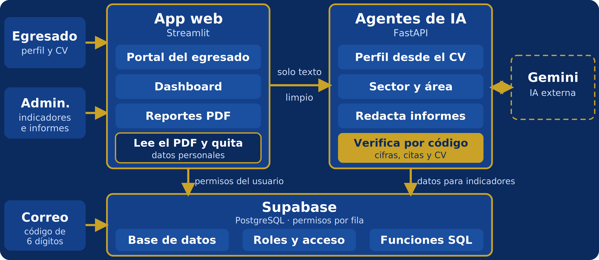

# SIGMA — Sistema Inteligente de Gestión y Monitoreo de Alumni

Plataforma en la nube para el seguimiento de egresados de **Ingeniería de Telecomunicaciones** (Universidad Santo Tomás, Bucaramanga). El egresado actualiza su propio perfil, la facultad ve indicadores, y una IA redacta informes de acreditación **cuyas cifras el código verifica**.

> Proyecto Integrador 2026-2 · Autor: Juan Esteban Páez Fonseca · Asesora: Elizabeth Gelves Gelves · Estado: en ejecución
>
> Demo en la nube: *(agregar aquí el enlace cuando la app sea pública)*

## El problema
Del registro institucional de 615 egresados, el 44 % no tiene situación laboral conocida y ningún dato indica cuándo se actualizó. Los informes de acreditación dependen de datos desactualizados y difíciles de verificar.

## Qué hace
- **Portal del egresado:** inicio de sesión con confirmación por código de 6 dígitos, perfil con consentimiento y fecha de cada declaración, y **carga de CV asistida** (la IA propone, la persona revisa y corrige antes de guardar).
- **Dashboard de administración:** empleabilidad por cohorte (siempre con dos tasas y el porcentaje desconocido), sector, áreas de desempeño, tecnologías y ubicación. Los datos reales y los sintéticos están siempre separados y etiquetados.
- **Revisión de perfiles nuevos:** la administración aprueba o descarta, viendo lo declarado y los posibles duplicados.
- **Informes de acreditación en PDF:** narrativa redactada por IA, con indicadores calculados por código y verificación automática de cifras y citas.

## Arquitectura



| Capa | Tecnología |
|---|---|
| Aplicación web | Streamlit |
| Agentes de IA | FastAPI + Gemini |
| Datos, autenticación y permisos | Supabase (PostgreSQL con permisos por fila) |

## Principios de diseño
1. **El código calcula.** Los indicadores salen de SQL y pandas, no de la IA.
2. **La IA propone o redacta.** Clasifica sector y área, lee CV y escribe la narrativa del informe.
3. **El código verifica.** Cada cifra citada en un informe y cada dato propuesto desde un CV debe existir en los datos de origen; si no, se descarta o el informe se marca "requiere revisión".
4. **Privacidad primero.** Antes de enviar un CV a la IA se le quitan nombre, correos, teléfonos, direcciones, documentos y enlaces; el PDF no se guarda; la persona acepta y ve el texto exacto que se envió.

## Seguridad
- Dos roles (`admin`, `egresado`) y **permisos a nivel de fila (RLS)**. La llave pública no puede leer ninguna tabla ni llamar ninguna función.
- El egresado no escribe directo en las tablas: todo pasa por funciones SQL que validan y solo tocan su propio registro.
- `python verificar_rls.py` comprueba esto contra una base real.

## Cómo correrlo
Requiere Python 3.11+ y un proyecto de Supabase y una clave de Gemini propios.

```bash
python -m venv .venv
# Windows: .venv\Scripts\activate      Linux/macOS: source .venv/bin/activate
pip install -r requirements.txt
cp .env.example .env        # y completar las claves; el .env real nunca se sube
```

**Base de datos** (en el SQL Editor de Supabase, en este orden):
`schema.sql` → `fase1_esquema.sql` → `fase2a_seguridad.sql` → `fase2b_perfil.sql` → `fase2b_descartar_perfiles.sql` → `fase2c_cv.sql` → `promover_admin.sql` (editar con el correo del administrador).

**Ejecución local** (dos terminales):
```bash
uvicorn main:app --reload      # agentes de IA
streamlit run app.py           # aplicación web
```

**Despliegue:** la aplicación en Streamlit Community Cloud y los agentes en Render; las mismas variables de `.env.example` van en los secretos de cada servicio.

## Pruebas
```bash
python tests/ejecutar_todas.py
```
Usan datos inventados y simulan Supabase y la IA: no necesitan claves ni gastan cuota. Ver `tests/LEEME.md`.

| Archivo | Qué comprueba |
|---|---|
| `prueba_privacidad.py` | que al limpiar un CV no quede ningún dato personal y sí el contenido profesional |
| `prueba_lectura_pdf.py` | que los PDF escaneados, protegidos, corruptos o enormes se rechacen con un mensaje claro |
| `prueba_verificacion_cv.py` | que lo que la IA proponga al leer un CV deba estar escrito en el CV |
| `prueba_servidor_agentes.py` | clave obligatoria, límites de tamaño y que un fallo de la IA no filtre el texto del CV |
| `prueba_cv_portal.py` | la pantalla del egresado de punta a punta, con errores y límites de uso |

## Estructura
| Archivo | Para qué sirve |
|---|---|
| `app.py` | aplicación web: portal, dashboard, revisión, reportes |
| `main.py`, `proveedor_ia.py`, `agente_reportes.py` | servicio de agentes y acceso a la IA |
| `privacidad.py`, `cv_texto.py`, `verificacion_cv.py` | limpieza de datos personales, lectura de PDF y verificación de lo propuesto |
| `informe_pdf.py` | generación del informe en PDF |
| `taxonomia.py` | listas cerradas de sectores y áreas |
| `clasificar_experiencias.py`, `enriquecer_biografias.py` | clasificación de sector/área y extracción de tecnologías |
| `*.sql` | esquema, permisos y funciones de la base de datos |
| `migrar_excel.py`, `generar_sinteticos.py` | carga de datos (el Excel institucional **no** se incluye) |
| `verificar_rls.py` | verificación de permisos contra la base real |

## Datos
Este repositorio **no contiene datos de egresados reales**. Los scripts de migración esperan un archivo propio; `generar_sinteticos.py` crea datos ficticios para probar.

## Limitaciones y siguientes pasos
- El texto de consentimiento es un borrador pendiente del texto oficial de la universidad (Ley 1581 de 2012).
- El correo de confirmación sale de una cuenta de proyecto, no de un dominio institucional, y falta la recuperación de contraseña.
- La clasificación de sector y área por IA se validó sobre una muestra pequeña (30 casos, no ciega, un solo revisor): es indicativa y siempre se muestra como "inferido por IA".
- Los servicios usan planes gratuitos, con cuotas y tiempos de arranque.
- La cobertura real depende de que los egresados participen.